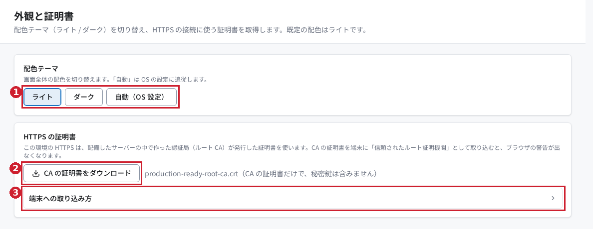
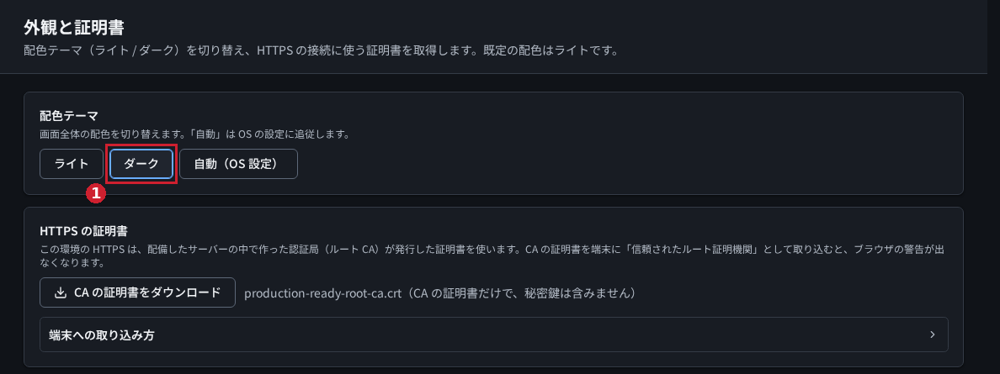
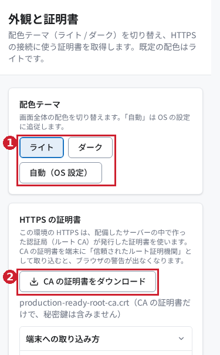

# Production Ready RAG の外観と証明書を使ってみる

## はじめに

「外観と証明書」では、画面の配色を選び、HTTPS の接続に使う CA 証明書を取得できます。CA（認証局）とは、接続先の証明書を発行する仕組みです。

この記事では、ライト・ダーク・OS に合わせる配色を切り替え、証明書のダウンロードと端末への取り込み案内を確認します。

> 2026年10月28日に実画面で確認しました。証明書を端末に取り込む操作と、取り込み後にブラウザーの警告が消えることは未確認です。

## 前提条件

- RAG にログインでき、「システム設定」の「外観と証明書」を開く権限があること。表示されない場合は管理者に確認してください。
- 証明書を取得する場合は、その環境が CA 証明書を配布していること。
- 端末に証明書を取り込む場合は、管理者から配布元が正しいことを確認でき、端末の証明書設定を変更する許可があること。

配色は、操作したブラウザーの保存領域に記録されます。ほかの利用者の画面や、サーバーの認証設定を変更するための操作ではありません。

## 今回使うサンプル

[配色の確認シナリオ.json](samples/配色の確認シナリオ.json) は、練習する順序と確認事項を記した日本語の合成データです。[練習用チェックシート.txt](samples/練習用チェックシート.txt) と一緒に使えます。架空の練習名で新しく作成しており、実際の利用者や業務データは含みません。

この機能にはファイルのアップロードや JSON の読み込みはありません。サンプルは手元で読む補助資料です。画面で選ぶ「ダーク」などの値だけを使います。

証明書は接続先の環境から取得する必要があります。合成の証明書で信頼設定を再現することはできないため、サンプルにも記事にも実環境の証明書は同梱していません。

## 操作手順

### 1. 「外観と証明書」を開く

左のナビゲーションで「システム設定」を展開し、「外観と証明書」を選びます。見出し「外観と証明書」と、「配色テーマ」「HTTPS の証明書」が表示されれば、この画面を開けています。

図1：①配色の選択、②証明書のダウンロード、③取り込み案内。確認環境ではダウンロードボタンが表示されました。

### 2. 「ダーク」に切り替える

「配色テーマ」の「ダーク」を押します。背景と文字の配色がすぐ切り替わり、「ダーク」が選択状態になります。保存ボタンを押す操作はありません。

図2：①「ダーク」の選択状態。ページを再読み込みしても、今回の確認ではダークが保持されました。

元の配色に戻すときは「ライト」を押します。確認を始める前の選択を控えておくと、最後に戻しやすくなります。

### 3. 必要に応じて「自動（OS 設定）」を選ぶ

端末の OS（基本ソフトウェア）の配色に合わせたい場合は、「自動（OS 設定）」を押します。端末側がダークなら暗い配色、ライトなら明るい配色になります。

今回の確認では、ブラウザーに伝える OS の配色条件をライト／ダークに切り替え、表示が追従することを確認しました。実際の端末の OS 設定画面は操作していません。

### 4. CA の証明書をダウンロードする

「HTTPS の証明書」で「CA の証明書をダウンロード」を押します。`production-ready-root-ca.crt` が保存されれば、取得できています。`.crt` は証明書ファイルの拡張子です。保存先はブラウザーの設定に従います。

今回の実操作では、ファイルをダウンロードし、証明書として読み取れることまで確認しました。配布ファイルに秘密鍵は含まれない仕様です。

### 5. 「端末への取り込み方」を開く

「端末への取り込み方」を押し、利用する端末・ブラウザーの案内を確認します。Windows、macOS、iPhone / iPad、Android、Edge、Chrome、Firefox の説明が表示されます。

図3：①を開くと、利用する端末に合わせた案内を読めます。画面の内容は確認済みですが、各端末への実際の取り込みは未実施です。

取り込む前に、証明書が接続先環境の管理者から提供されたものか確認します。取り込み後は、画面の案内に従ってブラウザーを開き直し、対象環境を開いて警告の有無を確認してください。組織で管理された端末では、管理者による対応が必要になる場合があります。

## 結果の確認

| 操作 | 確認すること |
|---|---|
| ライト／ダーク | 押したボタンが選択状態になり、画面の配色が変わる |
| 再読み込み | 同じブラウザーで選んだ配色が保持される |
| 自動（OS 設定） | OS の配色に合わせて表示が切り替わる |
| 証明書の取得 | `production-ready-root-ca.crt` が保存される |
| 案内の表示 | 「端末への取り込み方」の下に端末別の説明が出る |

図4：幅375pxの表示。①配色のボタンは折り返され、②証明書のダウンロードも操作できます。横方向のはみ出しがないことを確認しました。

## よくあるつまずきと対処

### 保存ボタンが見つからない

配色はボタンを押すと即座に反映され、ブラウザー内に保存される仕様です。「ダーク」を選んだ後の再読み込みでも保持されることを確認しました。

### 「自動」を選んでも色が変わらない

OS がライトのままなら、表示もライトになります。自動は定期的に配色を変える機能ではなく、OS の配色に従う機能です。

### 別のブラウザーや端末で配色が違う

配色はブラウザー内に保存されるため、必要なブラウザーで選び直します。ブラウザーの保存データを消した場合も、選び直しが必要です。

### 証明書のダウンロードボタンがない

実装では、証明書を配布していない、または取得可否を確認できない場合に「この環境では HTTPS の自己署名の証明書を使っていません。」という案内を表示します。配備状況や接続を管理者に確認してください。今回の環境ではボタンが表示されており、この案内の実画面は撮影していません。

### 証明書を取得したのにブラウザーの警告が消えない

ダウンロードと端末の信頼設定への取り込みは別の操作です。画面の「端末への取り込み方」を確認してください。警告が消えることは今回未確認のため、取り込み先や証明書の対応関係は環境の管理者と確認してください。

## まとめ

「外観と証明書」で、見やすい配色を選び、環境の CA 証明書を取得して取り込み案内を開けます。配色はブラウザーごとに選びます。証明書の信頼設定は、正しい配布元を確認してから進めてください。

実操作の範囲と未確認事項は[検証記録](検証記録.md)にまとめています。
