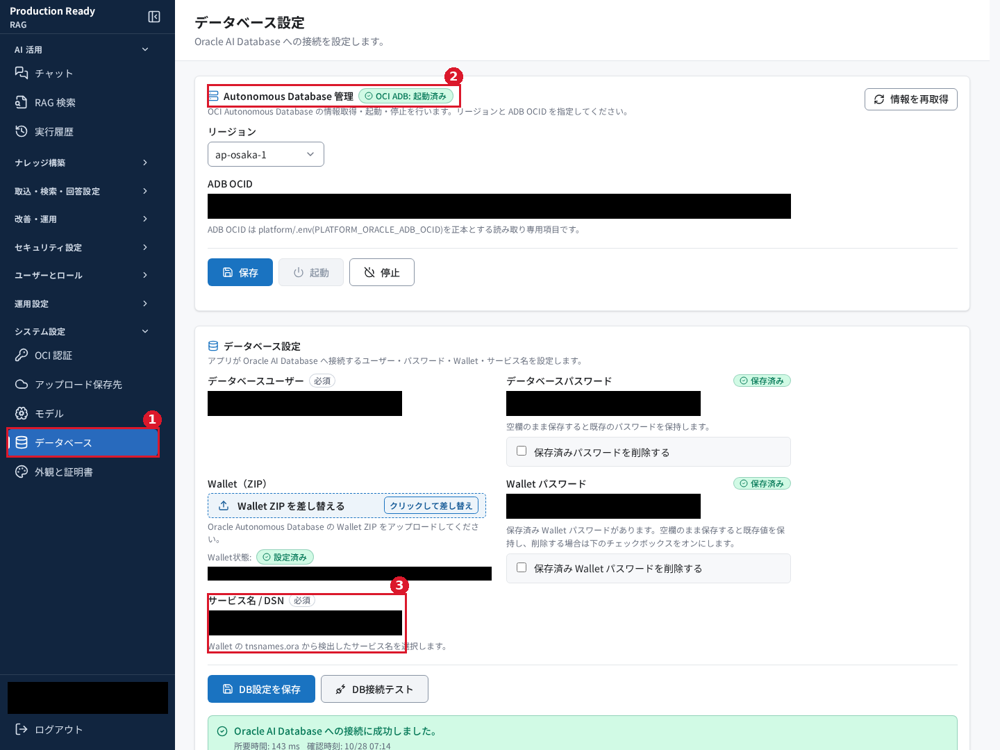
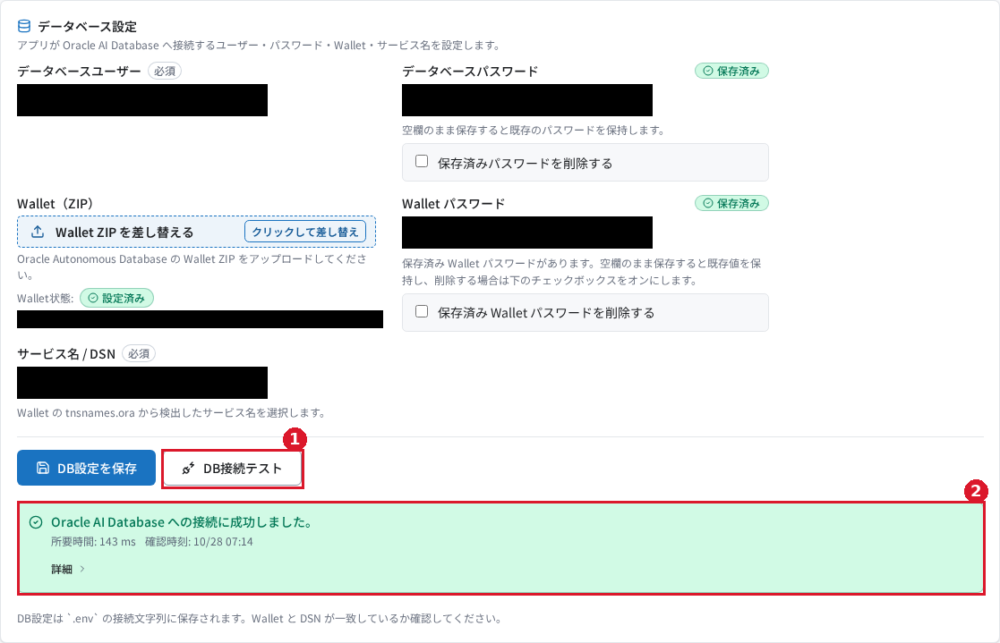
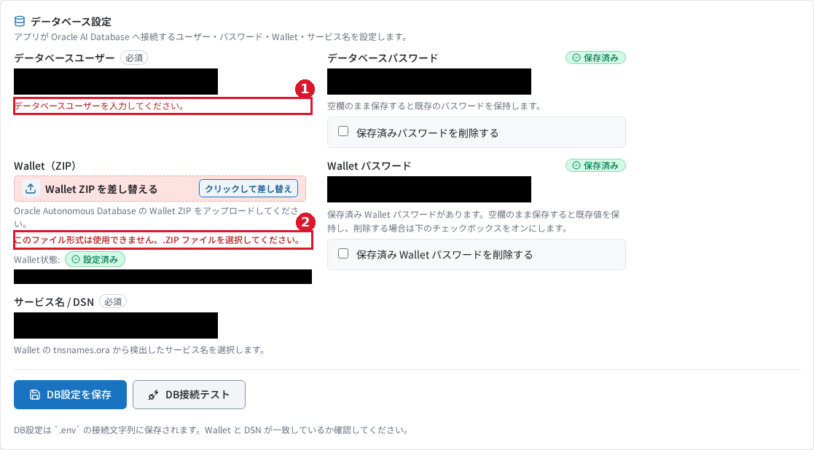
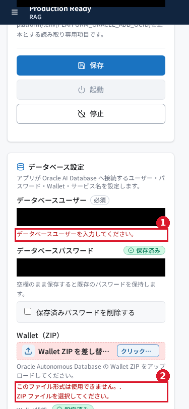
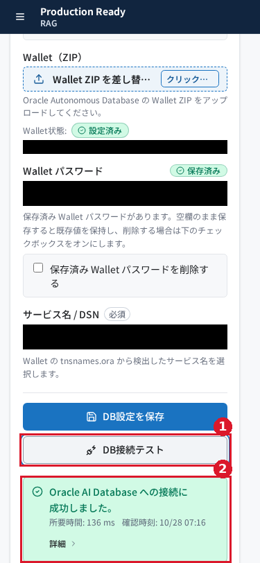

# RAG のデータベース設定を使ってみる

## はじめに

RAG は、文書の索引や会話などのデータを Oracle AI Database に保存します。**システム設定 → データベース**では、その接続に使うユーザー、パスワード、Wallet、サービス名を確認・設定できます。

この記事では、画面の読み方、DB 接続テスト、入力エラーの確認を説明します。**Wallet** は、暗号化した接続に使う証明書などをまとめたファイルです。**DSN** は接続先を指定する情報で、この画面では Wallet 内のサービス名から選びます。

実画面で接続成功と合成入力のエラーを確認しています。既存環境を保護するため、設定保存、Wallet の差し替え・再取得、DB の起動・停止は実施していません。それらの手順は実装を照合した説明です。

## 前提条件

- RAG にログインでき、「システム設定」の「データベース」を開ける権限があること。今回はシステム管理者で確認しました。
- 接続テストには、利用可能なデータベース、接続ユーザー・パスワード、その接続先に対応する Wallet が必要です。
- ADB の情報表示には OCI 認証設定と ADB OCID が必要です。**ADB** は Oracle Autonomous AI Database の略称、**OCID** は OCI のリソースを識別する ID です。
- 保存や Wallet の差し替えを練習する場合は、独立した検証環境を用意してください。データベース設定は RAG・NL2SQL・Agent の共通設定です。

環境のアドレスは、環境管理者から案内された `<環境URL>/rag/` を使います。認証情報を記事やスクリーンショットに転記しないでください。

## 今回使うサンプル

| ファイル | 用途 |
|---|---|
| [入力確認用.json](samples/入力確認用.json) | 空白のユーザー名による必須入力エラーと、架空の記入例を説明する日本語のデータ |
| [架空サンプル_形式確認用.txt](samples/架空サンプル_形式確認用.txt) | ZIP 以外のファイルが拒否されることを確かめる日本語のテキスト |

サンプルは新しく作成した合成データです。実在する接続先・パスワード・鍵・証明書を含みません。`.txt` は、**非対応形式のエラーを学ぶため**に使います。名前だけを `.zip` に変更しても Wallet にはなりません。

接続成功は、既に設定されていた接続情報を変更せずに確認しました。添付サンプルだけで接続成功を再現することはできません。

## 操作手順

### 1. データベース設定を開く

1. 左のナビゲーションで **システム設定** を開きます。
2. **データベース** を選びます。
3. 見出し **データベース設定** と、上部の **Autonomous Database 管理**、下部の **データベース設定** が表示されることを確かめます。

*図1：①画面への入口、②ADB の状態、③サービス名 / DSN です。接続先などは黒塗りです。*

### 2. ADB の状態を確認する

上部の **Autonomous Database 管理** には、リージョンと ADB OCID が表示されます。今回の画面では **OCI ADB: 起動済み** と表示されました。ADB OCID は読み取り専用です。変更が必要な場合は環境管理者へ相談してください。

**情報を再取得** は、単なる表示更新ではありません。実装上はリージョン等の設定保存を行い、続いて OCI から Wallet を取得してサーバーへ設定します。このボタンと同区画の **保存** は、既存 Wallet を保護するため今回は押していません。

**起動** と **停止** はデータベースの稼働状態を変えます。サービス利用に影響するため、画面確認のために押す必要はありません。今回は、既に起動済みであることだけを確認しました。

### 3. 接続情報の項目を確認する

下部の **データベース設定** で、次の項目を確認します。

| 項目 | 入力・確認する内容 |
|---|---|
| データベースユーザー | 管理者が用意したアプリ用ユーザー。架空の記入例は `SAMPLE_APP` |
| データベースパスワード | 新しく設定・更新する場合に入力。保存済みなら空欄で既存値を保持 |
| Wallet（ZIP） | 対象 DB の正しい Wallet ZIP。現在の状態は「Wallet状態: 設定済み」などで確認 |
| Wallet パスワード | 暗号化 Wallet の利用に必要な値。保存済みなら空欄で既存値を保持 |
| サービス名 / DSN | Wallet の `tnsnames.ora` から検出された接続サービスを選択。架空の名前の例は `sampledb_low` |

`tnsnames.ora` は、サービス名と接続先の対応を持つ Wallet 内の設定ファイルです。候補が検出されていない場合は、サービス名を直接入力する欄になります。今回の RAG 画面ではサービス名を選ぶ欄が表示されました。

**保存済みパスワードを削除する**、**保存済み Wallet パスワードを削除する**は、値を保持したい場合はオンにしません。

Wallet のファイルを選ぶ操作は、単なる入力準備ではなくアップロードを開始します。独立した検証環境以外では、練習用のファイルで差し替えないでください。また、Wallet が未設定で ADB OCID がある構成では、画面を開くと OCI からの Wallet 自動取得が動く仕様です。

### 4. DB 接続テストを実行する

1. 既存の設定を確認する場合は、入力値を変えずに **DB接続テスト** を押します。
2. 処理が終わるまで待ちます。
3. **Oracle AI Database への接続に成功しました。** と表示されることを確かめます。

*図2：①DB接続テスト、②成功結果です。所要時間は環境や実行ごとに変わります。*

このテストは**現在の入力欄の値**を使います。パスワードが空欄の場合は保存済みの値を使い、接続候補を保存せずに確認できます。OCI 認証設定の接続テストとは、この点が異なります。

DB 接続テストは接続と最小限の読み取りであり、設定保存や表の初期化は行いません。成功しても、文書の取込やモデル呼び出しまで成功するとは限りません。

### 5. 合成データで入力エラーを確かめる

この手順は、入力ミスを学ぶための例です。確認後はページを再読み込みし、未保存の入力を破棄します。

1. [入力確認用.json](samples/入力確認用.json)を開きます。
2. **データベースユーザー** を半角スペース3文字に置き換えます。
3. **DB接続テスト** を押します。
4. **データベースユーザーを入力してください。** と表示されることを確認します。この状態では DB 接続テストは送信されません。
5. **Wallet ZIP を差し替える** のファイル選択で、[架空サンプル_形式確認用.txt](samples/架空サンプル_形式確認用.txt)を指定します。選択ダイアログが ZIP のみを表示する場合は、ファイル形式の絞り込みを解除します。
6. **このファイル形式は使用できません。.ZIP ファイルを選択してください。** と表示されることを確認します。この非対応ファイルはアップロードされません。
7. ページを再読み込みします。離脱確認が表示された場合は、検証用の入力を破棄します。

*図3：①ユーザー名は空白だけでは受け付けません。②テキストファイルは Wallet ZIP として使えません。*

*図4：幅375pxでも、①必須入力、②ファイル形式のエラーを確認できます。*

### 6. 設定を変更する場合の保存手順を知る

以下は実装を照合した手順です。**今回は保存と正しい Wallet ZIP のアップロードを実行していません。**

1. 独立した検証環境で、管理者が用意したユーザー・パスワードを入力します。
2. 必要な場合だけ、対応する Wallet ZIP をアップロードします。Wallet の処理はファイル選択時に始まります。
3. **サービス名 / DSN** に対象 Wallet のサービス名を選びます。
4. **DB接続テスト** で接続を確認します。
5. **DB設定を保存** を押します。
6. **保存しました** の表示を確認し、再表示後もユーザー・サービス名とパスワードの保存状態が期待どおりであることを確認します。

上部の ADB 管理の **保存** と、接続情報の **DB設定を保存** は別の操作です。Wallet の差し替えも、DB設定の保存ボタンを押すまで保留される操作ではありません。

## 結果の確認

| 確認対象 | 成功の目印 | 今回の確認 |
|---|---|---|
| 画面表示 | 見出し「データベース設定」 | 実画面で確認 |
| ADB 状態 | 「OCI ADB: 起動済み」等の状態 | 起動済みを実画面で確認 |
| DB への接続 | 「Oracle AI Database への接続に成功しました。」 | 保存済み設定で Desktop・375px の両方を実測 |
| 必須入力 | 空白だけのユーザーに必須入力エラー | 合成入力で実画面確認 |
| 非対応ファイル | ZIP を求める形式エラー | 合成 `.txt` で実画面確認 |
| 設定の保存 | 「保存しました」と再表示後の保持 | 未実施。実装を照合 |
| Wallet の設定 | アップロード成功の通知と「設定済み」 | 新規設定・差し替えは未実施 |

*図5：狭い画面でも、接続成功のメッセージを確認しました。*

## よくあるつまずきと対処

| 状況 | 対処・注意点 | 根拠 |
|---|---|---|
| ユーザーを入力したつもりでもエラーになる | 半角スペースだけでは受け付けない。管理者から案内されたユーザー名を入力する | 合成入力で実測 |
| Wallet のファイルを選べない・拒否される | 正しい ZIP を選ぶ。拡張子の変更だけでは有効な Wallet にならない | `.txt` の拒否を実測。ZIP の内容検査は実装を照合 |
| 保存済みなのにパスワード欄が空に見える | 保存済みの表示を確認する。更新しない場合は空欄で既存値を保持する | 実画面と実装を確認 |
| ADB OCID を編集できない | 読み取り専用の仕様。環境管理者に設定の変更を依頼する | 実画面と実装を確認 |
| 「情報を再取得」を表示更新だけのつもりで押しそうになる | リージョン等の保存と Wallet 設定も伴う。環境への影響を確認してから実施する | 実装を照合。今回は未実施 |
| 接続テストが失敗する | 表示された案内を確認し、DB の起動状態、ユーザー・パスワード、Wallet とサービス名の一致、ネットワークを管理者と確認する | 実装のエラー分類を照合。接続障害は未再現 |

## まとめ

データベース設定では、ADB の状態と DB 接続情報を確認し、**DB接続テスト**で現在の入力値による接続を確かめられます。保存済みパスワードは、更新しない場合は空欄で保持します。

Wallet のファイル選択や **情報を再取得** は、サーバー側の設定に影響します。既存の環境では、最初に状態確認と接続テストから始め、変更が必要な場合にだけ管理者と設定作業を進めてください。

確認範囲と根拠は[検証記録](検証記録.md)にまとめています。
