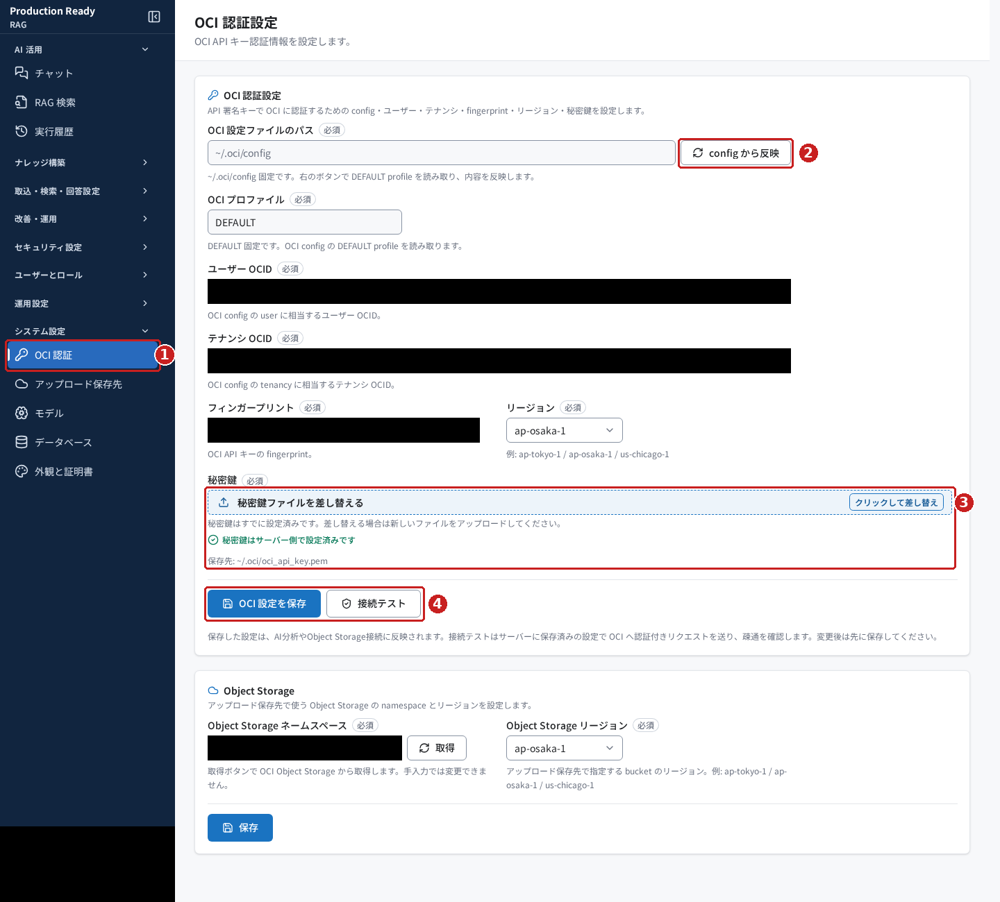
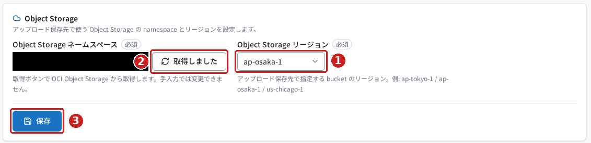
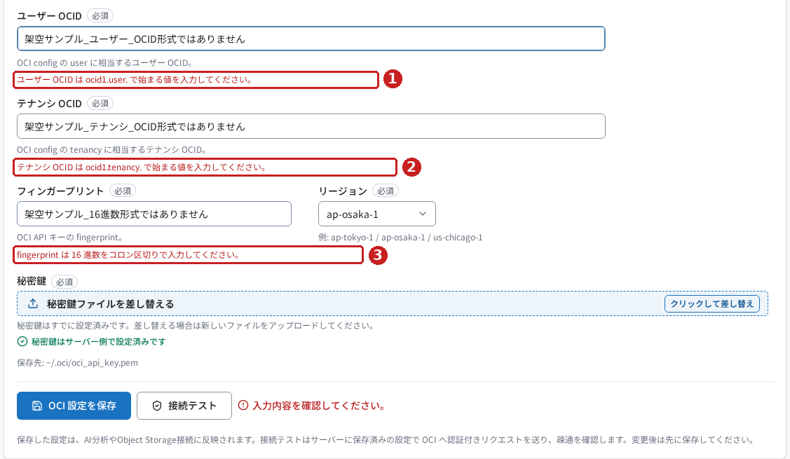
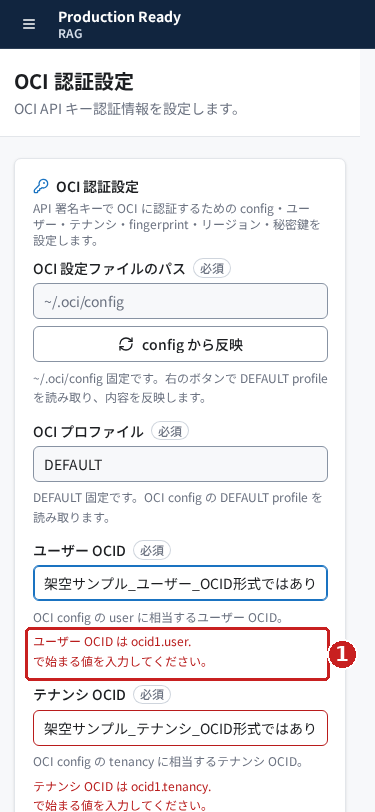

# Production Ready RAG の OCI 認証設定を使ってみる

## はじめに

RAG から OCI（Oracle Cloud Infrastructure）のサービスを使うには、呼び出す利用者を確認するための認証設定が必要です。

この記事では、**システム設定 → OCI 認証**を開き、設定項目の意味、保存と接続テストの順序、Object Storage の設定方法を確認します。初めて使う方が、どこに何を入力し、どの表示を成功の目印にすればよいかを理解することが目的です。

> **確認範囲について**
> 2026年10月28日に実画面で、画面表示・config 読込・合成入力の形式チェック・保存済み設定での接続成功・namespace 取得を確認しました。既存の共通設定を保護するため、正しい値の保存、秘密鍵のアップロード・差し替え、Object Storage 設定の保存は実施していません。これらの手順と期待表示は実装を照合した説明です。
>
> 画像は実際の画面キャプチャです。環境の識別情報とアカウント表示を黒塗りにし、説明対象に赤い枠と番号を追加しています。

## 前提条件

- RAG にログインできること。アクセス先は環境管理者から案内された `<環境URL>/rag/` を使用します。
- 「システム設定」の「OCI 認証」を開く権限があること。権限の識別子は `menu.settings_oci` です。
- 新しく設定する場合は、環境管理者が OCI の API 署名キーと対応する情報を用意していること。
- 操作の練習には、既存設定を上書きしない独立した検証環境を使用すること。

**API 署名キー**は、サービスへのリクエストが本人のものだと示すための鍵です。OCI 側に登録する公開鍵と、サーバー側で使う秘密鍵が対応している必要があります。

この設定画面は RAG・NL2SQL・Agent で共通の仕組みを使用します。共通の設定ファイルや秘密鍵を変更すると他の製品にも影響するため、既存設定を練習用データで置き換えないでください。

## 今回使うサンプル

[サンプル一式の説明](samples/README.md)から、次のファイルを開けます。内容と説明は日本語で、実際の認証情報は含みません。

| サンプル | 用途 |
|---|---|
| [入力エラー確認用.json](samples/入力エラー確認用.json) | 架空の値を画面へ手入力し、入力形式のエラーを確かめる |
| [OCI設定テンプレート.ini](samples/OCI設定テンプレート.ini) | サーバー側の設定ファイルと画面項目の対応を読む |
| [架空サンプル_秘密鍵ではありません.pem](samples/架空サンプル_秘密鍵ではありません.pem) | 秘密鍵の実体を含まない、認証不能なファイル例。実環境にはアップロードしていない |

JSON は入力例をまとめたファイルであり、この画面へアップロードするものではありません。INI は設定ファイルの形式の一つです。この画面の「config から反映」は、手元の INI ファイルを選択する操作ではありません。

**このサンプルだけでは OCI への認証成功は再現できません。** 接続成功の画像は、既に設定済みの認証を変更せずに確認したものです。新規設定には、環境管理者から案内された正しい値を使用してください。

## 操作手順

### 1. 「システム設定」から「OCI 認証」を開く

1. RAG にログインします。
2. 左のナビゲーションで **システム設定** を開きます。
3. **OCI 認証** を選びます。

画面の見出しに **OCI 認証設定**、下部に **Object Storage** が表示されれば、対象の画面を開けています。

*図1：①は開くメニュー、②はサーバーの設定の読込、③は秘密鍵の欄、④は認証設定の保存と接続テストです。黒塗り部分は環境の識別情報です。*

### 2. 設定項目を確認する

**OCID** は、OCI の利用者やリソースを識別する ID です。**テナンシ**は、OCI の契約・管理範囲に当たります。**フィンガープリント**は、公開鍵を識別するための値です。**リージョン**はサービスを利用する地域です。

| 画面の項目 | 入力・確認する内容 |
|---|---|
| OCI 設定ファイルのパス | 画面では `~/.oci/config` 固定。ブラウザーを開いている端末ではなく、バックエンドの実行ユーザー側のファイルを参照する |
| OCI プロファイル | 画面では `DEFAULT` 固定。プロファイルは設定のまとまりの名前 |
| ユーザー OCID | 環境管理者から案内された `<ユーザー_OCID>`。`ocid1.user.` で始まる値 |
| テナンシ OCID | 環境管理者から案内された `<テナンシ_OCID>`。`ocid1.tenancy.` で始まる値 |
| フィンガープリント | 対応する公開鍵の `<フィンガープリント>`。16進数をコロンで区切る形式 |
| リージョン | 利用するサービスの地域。画面の選択肢から選ぶ。この記事の例は `ap-osaka-1` |
| 秘密鍵 | 公開鍵に対応する `.pem` または `.key` ファイル。保存先表示は `~/.oci/oci_api_key.pem` |

正しい値が既に表示されていれば、新しく入力する必要はありません。図1では、既存の秘密鍵を検出したため「秘密鍵はサーバー側で設定済みです」と表示されています。この表示だけでは、OCI への接続成功までは確認できません。

### 3. 必要に応じて「config から反映」で読み込む

1. サーバー側の設定を読み直したい場合は、図1の② **config から反映** を押します。
2. **OCI config を読み込みました。** と通知され、対応する欄に値が反映されたことを確認します。

この操作は実画面で確認しました。読み込む対象は、バックエンドが使用する設定ファイルです。手元のサンプルファイルを画面へアップロードする操作ではありません。

読み込んだ後に変更する場合は、次の手順で保存します。

### 4. 新しく設定する場合は、認証情報を入力して保存する

> この手順は実装に基づく説明です。既存設定を保護するため、今回の環境では保存と秘密鍵の変更を実施していません。

1. 手順2の「ユーザー OCID」「テナンシ OCID」「フィンガープリント」を正しい値で入力します。
2. 「リージョン」を選びます。
3. 秘密鍵が未設定の場合は、秘密鍵のファイル選択欄から対応するファイルを選びます。設定済みの場合は **秘密鍵ファイルを差し替える** と表示されます。変更が必要な場合だけ操作してください。
4. アップロードに成功した場合の通知は **秘密鍵ファイルをアップロードしました。** です。
5. **OCI 設定を保存** を押します。
6. 保存に成功した場合の通知は **OCI 認証設定を保存しました。** です。

**秘密鍵はファイル選択後にアップロードされます。** 「OCI 設定を保存」を押すまで保留する操作ではありません。秘密鍵の差し替えと認証情報の保存は別の操作です。

ファイルは `.pem` または `.key` に対応します。アップロードの上限は 64 KiB で、秘密鍵の PEM 形式を確認します。PEM は鍵などを文字で記録する形式です。パスフレーズ付きの暗号化秘密鍵は、この画面のアップロードでは受け付けません。

### 5. 「接続テスト」で保存済みの設定を確かめる

1. 設定を変更した場合は、先に **OCI 設定を保存** を押します。
2. **接続テスト** を押します。
3. 結果パネルのメッセージと、各確認段階を確かめます。

**接続テストはサーバーに保存済みの設定を使用します。** 未保存の入力欄の値をテストする操作ではありません。

*図2：①の成功メッセージと、②の4段階がすべて「成功」であることを確認します。これは今回、設定済みの認証で実際に得られた結果です。*

| 確認段階 | 確かめること |
|---|---|
| 設定の形式 | 必須項目と設定の形式がそろっているか |
| 鍵の読み取り | 秘密鍵を読み取れ、フィンガープリントと一致するか |
| リージョン到達 | OCI の接続先から応答があるか |
| 認証（API 応答） | 認証付きの API 呼び出しが成功するか |

今回の成功メッセージは **OCI へ認証付きで接続できました（Object Storage GetNamespace）。** でした。GetNamespace は、後述する Object Storage のネームスペースを取得する読み取り操作です。

### 6. Object Storage の情報を取得する

**Object Storage** はファイルなどを保存する OCI のサービスです。**ネームスペース（namespace）**は、その保存領域を識別する名前です。ファイルを入れる容器に当たるバケットの名前とは別です。

1. 画面下部の **Object Storage** へ移動します。
2. **Object Storage リージョン** を選びます。アップロード先のバケットがある地域に合わせます。
3. **Object Storage ネームスペース** の右にある **取得** を押します。
4. **Object Storage namespace を取得しました。** と通知され、ネームスペース欄に値が入ることを確かめます。ボタンは **取得しました** の表示になります。
5. 変更を保存する場合は、この区画の **保存** を押します。成功時の通知は **Object Storage 設定を保存しました。** です。

取得は実画面で確認しました。ネームスペース欄は読み取り専用で、手入力では変更できません。最後の保存操作は、既存設定を保護するため未実施です。

*図3：操作順は①リージョン、②取得、③保存です。撮影した時点では取得に成功しています。③の保存は今回実行していません。*

バケット名やファイルの保存先そのものは、別の **アップロード保存先** 画面で設定します。

### 7. 入力例で形式のチェックを確かめる

この手順は、**独立した検証環境で入力エラーを学ぶための例**です。OCI の接続成功を再現するものではありません。

1. [入力エラー確認用.json](samples/入力エラー確認用.json)を開きます。
2. 次の3つの値を、画面の対応する欄へ入力します。
3. **OCI 設定を保存** を押します。
4. 各欄に形式のエラーが表示されることを確認します。
5. 確認後はページを再読み込みし、検証用の入力を破棄します。離脱の確認が出た場合は、検証用の入力を破棄する操作を選びます。

| 項目 | 架空の入力例 |
|---|---|
| ユーザー OCID | `架空サンプル_ユーザー_OCID形式ではありません` |
| テナンシ OCID | `架空サンプル_テナンシ_OCID形式ではありません` |
| フィンガープリント | `架空サンプル_16進数形式ではありません` |

*図4：①ユーザー OCID、②テナンシ OCID、③フィンガープリントの形式エラーです。入力例はすべて合成データです。*

今回はこの3つのエラーを実画面で確認しました。合成データは保存されていません。

*図5：幅375pxでも、赤枠のエラーの内容を確認できます。長い入力値は欄の中で一部が隠れるため、カーソルを動かして確認します。*

## 結果の確認

次の点を順に確かめます。保存の通知と、接続の成功は別々に確認してください。

| 確認すること | 成功の目印 | 今回の確認 |
|---|---|---|
| 画面を開けたか | 見出しが「OCI 認証設定」 | 実画面で確認 |
| config を読めたか | 「OCI config を読み込みました。」 | 実画面で確認 |
| 正しい認証情報を保存できたか | 「OCI 認証設定を保存しました。」。再表示後も入力した値が表示される | 未実施。実装の保存処理と通知を確認 |
| 秘密鍵をアップロードできたか | 「秘密鍵ファイルをアップロードしました。」 | 未実施。実装のアップロード処理と通知を確認 |
| OCI に接続できたか | 認証付き接続の成功メッセージと4段階すべての「成功」 | 保存済み設定で実画面・実OCI応答を確認 |
| namespace を取得できたか | 「Object Storage namespace を取得しました。」と欄への反映 | 実画面・実OCI応答を確認 |
| Object Storage 設定を保存できたか | 「Object Storage 設定を保存しました。」。再表示後も値が表示される | 未実施。実装の保存処理と通知を確認 |

この接続テストの成功だけでは、文書の取込、モデルの利用、バケットへの書込みまでは確認できません。それぞれの設定画面や機能で、別途確認します。

## よくあるつまずきと対処

| 状況 | 対処・注意点 | 根拠 |
|---|---|---|
| OCID やフィンガープリントで入力エラーになる | 項目を取り違えていないか確認する。OCID は指定の接頭辞、フィンガープリントは16進数のコロン区切りにする | 合成入力で実画面確認 |
| 入力を変えたのに接続テストの結果が変わらない | 接続テストは保存済みの設定を使用する。変更後は先に認証設定を保存する | 画面の説明と実装を確認 |
| 手元の config ファイルを選べない | 「config から反映」はバックエンド側の設定を読む。サーバーへの配置は環境管理者に相談する | 実画面と実装を確認 |
| namespace を入力できない | 手入力できない仕様。リージョンを選び、「取得」を押す | 実画面確認 |
| 保存したつもりでも Object Storage 設定が反映されない | 認証設定の「OCI 設定を保存」と、Object Storage の「保存」は別々。変更した区画で保存する | 実装を確認。保存は未実測 |
| 秘密鍵が見つからない、読み取れない | 対応する鍵の有無と権限を環境管理者が確認する。実装は設定ディレクトリを `0700`、設定ファイルと秘密鍵を `0600` で扱う | 実装を確認。障害は未再現 |
| パスフレーズ付きの鍵をアップロードできない | この画面では暗号化秘密鍵のアップロードを受け付けない。組織の鍵管理手順に従い、環境管理者に相談する | 実装を確認。アップロードは未実測 |
| 接続テストの途中で「失敗」、後続が「未実施」になる | 失敗した段階の案内を先に確認する。「未実施」は、その段階をまだ確認していない意味 | 実装を確認。障害は未再現 |

## まとめ

「OCI 認証設定」では、認証情報と秘密鍵を設定し、保存済みの設定で OCI への接続を確認できます。Object Storage の namespace は「取得」で読み込み、認証設定とは別に保存します。

初めて設定する場合は、**必要な情報の準備 → 認証情報と秘密鍵の設定 → 認証設定の保存 → 接続テスト → namespace の取得と保存**の順で進めます。既存設定がある環境では、まず内容と接続結果を確認し、変更が必要な項目だけを扱ってください。

記事・画像・サンプルの確認範囲と、未実施事項は[検証記録](検証記録.md)にまとめています。
