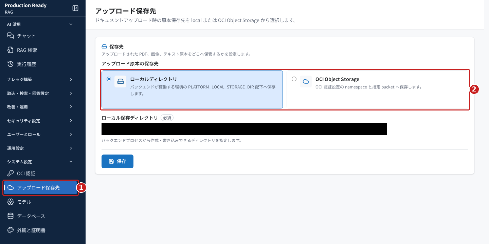
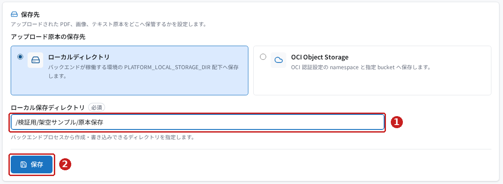
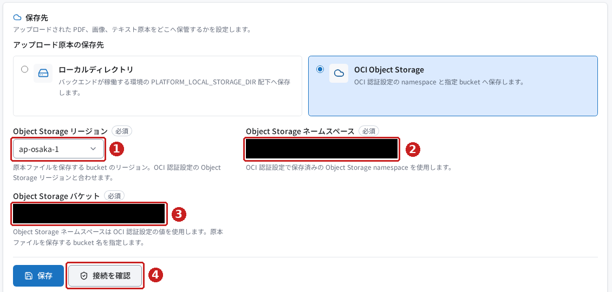
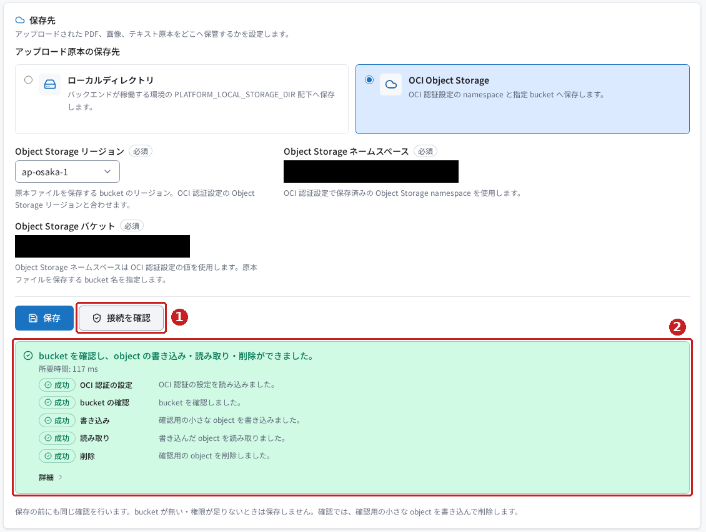
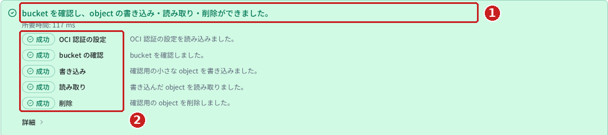
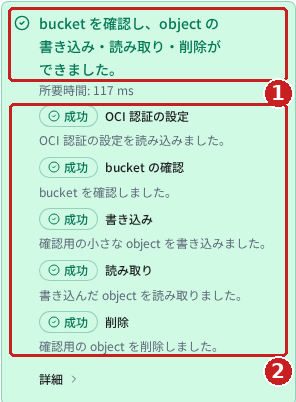
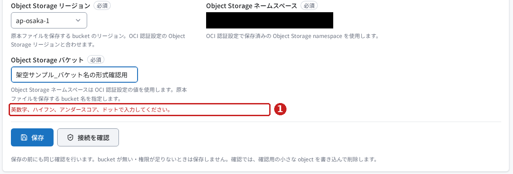
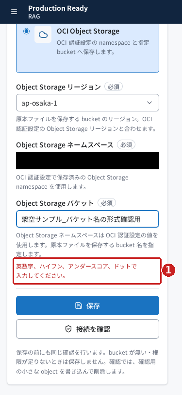
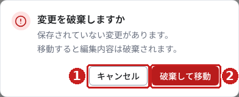

# Production Ready RAG のアップロード保存先を使ってみる

## はじめに

RAG にアップロードした PDF・画像・テキストなどの**原本ファイル**を、どこへ保存するかを設定する画面です。「ローカルディレクトリ」と「OCI Object Storage」から選びます。

この記事では、保存先の選び方、入力する項目、接続確認の結果の読み方を確認します。前の記事「[OCI 認証設定](../oci-authentication/README.md)」が、OCI を利用するための認証を扱うのに対し、この画面では原本の保管場所を指定します。

> **今回の確認範囲**
>
> 2026年10月28日に実画面で、保存先の切替え、日本語の合成値の未保存入力、バケット名の形式エラー、変更破棄の確認を操作しました。追加確認では、設定済みの OCI 認証を使って検証専用バケットを一時作成し、「接続を確認」の5段階すべての成功を確認しました。確認専用オブジェクトが削除された後、空の一時バケットも削除しました。
>
> 既存設定を保護するため、保存先の変更を保存していません。保存の成功通知などは実装を確認した説明です。画像は実画面の機密情報を黒塗りし、重要な箇所に赤枠と番号を加えています。

## 前提条件

- RAG にログインし、「システム設定 → アップロード保存先」を開けること。必要なメニュー権限は `menu.settings_upload_storage` です。
- 新しい保存先を試す場合は、既存の運用に影響しない検証環境を用意すること。
- ローカル保存では、バックエンドの実行ユーザーが書き込めるディレクトリを、環境管理者が準備していること。
- OCI Object Storage では、OCI 認証設定、リージョン、ネームスペース、保存に使用するバケットとその操作権限が準備されていること。

**バックエンド**は RAG の処理を実行するサーバー側のプログラムです。ここでいう「ローカル」は、ブラウザーを開いている手元のパソコンではなく、そのバックエンドの実行環境を指します。

保存先の設定は共通の設定ファイルへ保存されます。同じ環境の他の製品にも影響するため、確認だけのつもりで運用中の保存先を変更しないでください。

## 今回使うサンプル

[サンプルの説明](samples/README.md)から、次の日本語ファイルを開けます。実在する人物・顧客・組織や既存の業務データは使っていません。

| ファイル | 用途 |
|---|---|
| [入力例.json](samples/入力例.json) | 架空のローカル保存パスと、バケット名の形式エラーを起こす値。画面へ手入力して使用 |
| [架空サンプル_原本保存確認.txt](samples/架空サンプル_原本保存確認.txt) | 保存先設定後の確認に利用できる合成のテキスト原本。今回はアップロードしていない |
| [一時バケット検証のチェックリスト.txt](samples/一時バケット検証のチェックリスト.txt) | 一時バケットの準備、5段階の成功確認、削除までを記録する日本語の確認表 |

この画面には、JSON や原本文書をアップロードする欄はありません。ここで保管場所を設定し、文書自体のアップロードは別の「文書アップロード」で行います。

### 今回の一時バケットについて

今回の追加検証では、RAG に設定されている OCI 認証と同じ認証を使い、設定済みのコンパートメント（OCI のリソースを管理する区画）内に、検証専用の非公開バケットを新しく作成しました。既存バケットの流用や、保存先設定の上書きはしていません。

一時バケットは RAG の画面外で OCI API を使って作成しました。この設定画面にバケット作成機能はありません。読者が再現する場合は、環境管理者に一時バケットの準備と削除を依頼し、その `<検証用バケット名>` を使ってください。バケットは非公開、バージョン管理なしの設定で確認しました。

接続確認で作成される小さなオブジェクトは、システムが生成する固定の確認用データです。添付のテキスト原本を送信する操作ではありません。検証後はオブジェクトが残っていないことを確認してから、一時バケットだけを削除しました。

## 操作手順

### 1. 「アップロード保存先」を開く

1. 左のナビゲーションで **システム設定** を開きます。
2. **アップロード保存先** を選びます。
3. 見出しに **アップロード保存先**、画面内に **保存先** と表示されることを確認します。

*図1：①から画面を開き、②で保存先の種類を選びます。この確認環境では、保存済みの選択はローカルディレクトリでした。*

### 2. ローカルディレクトリに保存する場合

1. **ローカルディレクトリ** を選びます。
2. **ローカル保存ディレクトリ** に、環境管理者が準備した保存先を入力します。
3. 入力内容を確認して、**保存** を押します。
4. 保存成功時の通知 **保存しました** を確認し、再表示したときも設定が残っていることを確かめます。

次の図では、入力例として `/検証用/架空サンプル/原本保存` を入力しました。これは架空の説明用パスです。実際にディレクトリを作成したり、設定を保存したりはしていません。

*図2：①へ保存パスを入力し、設定を変更する場合に②で保存します。今回実際に確認したのは①の未保存入力までです。*

ローカル保存には、この画面の「接続を確認」ボタンはありません。保存できたことと、実際に原本を書き込めることは別に確認してください。

### 3. OCI Object Storage に保存する場合

**OCI Object Storage** は、ファイルなどを保存する OCI のサービスです。**バケット（bucket）**はファイルを入れる容器、**ネームスペース（namespace）**は保存領域を識別する名前です。**リージョン**は、利用するサービスの地域です。

1. **OCI Object Storage** を選びます。選択だけでは保存されません。
2. **Object Storage リージョン** で、保存先バケットがある地域を選びます。この記事の選択例は `ap-osaka-1` です。
3. **Object Storage ネームスペース** の表示を確認します。OCI 認証設定で保存済みの値が使われ、この画面では手入力できません。
4. **Object Storage バケット** に、準備済みの `<検証用バケット名>` を入力します。

*図3：実際に一時バケットを入力した画面です。①リージョン、②ネームスペース、③バケットを確認してから、④「接続を確認」を押します。環境の名前は黒塗りです。*

リージョンやネームスペースが不足している場合は、警告と **OCI 認証設定を開く** の案内が表示される実装です。その場合は、先に[OCI 認証設定の記事](../oci-authentication/README.md)を参照してください。この不足状態は、今回の環境では再現していません。

### 4. 「接続を確認」で結果を読む

1. 必要な項目を入力した状態で、**接続を確認** を押します。
2. 結果のメッセージと、各確認段階を確認します。

**この操作は、画面に入力中の値を使います。設定の保存は行いません。** OCI 認証設定の「接続テスト」が保存済みの設定を使うのとは、扱いが異なります。

ただし、確認がバケットの参照まで成功すると、**小さな確認専用オブジェクトを新規作成し、読み取って削除します**。オブジェクトは Object Storage 上のファイルに当たります。操作する保存先と権限を、あらかじめ環境管理者に確認してください。

| 確認段階 | 確認すること |
|---|---|
| OCI 認証の設定 | 認証の設定を読み込めるか |
| bucket の確認 | バケットがあり、参照できるか |
| 書き込み | 確認専用オブジェクトを新しく書けるか |
| 読み取り | 書いたオブジェクトを読めるか |
| 削除 | 確認専用オブジェクトを削除できるか |

今回の一時バケットでは、実際に **bucket を確認し、object の書き込み・読み取り・削除ができました。** と表示されました。

*図4：①「接続を確認」を押し、②の成功結果が表示された実画面です。設定の保存は押していません。*

*図5：①の成功メッセージと、②の5段階すべてが「成功」であることを確認します。確認用オブジェクトの削除まで実際に完了しました。*

*図6：同じ実際の成功結果を幅375pxでも確認しました。画面幅だけを変えて撮影しており、結果の内容を画像で作り替えていません。*

初回の確認では、別の登録済みバケット名で404となりました。その後、今回の検証専用バケットを用意して全段階の成功を確認しました。404の表示だけでは、存在しないのか権限不足なのかは断定できません。失敗する場合は、バケット名・リージョン・ネームスペースと参照権限を確認してください。

### 5. 接続を確かめてから保存する

> 保存は既存設定を保護するため未実施です。以下は実装に基づく操作と期待結果です。

1. 接続確認に使用した入力内容を確かめます。
2. **保存** を押します。OCI を選んだ場合、保存時にも接続確認を行います。
3. 正常に保存された場合は **保存しました** と通知されます。
4. 画面を再表示し、保存先の種類・リージョン・ネームスペース・バケットが想定どおりか確認します。

バケットがない・権限がないなどの明確な設定エラーでは、保存を止める実装です。一方、時間切れなどの一時的な問題で確認できなかった場合は、設定を保存して **保存しましたが、OCI Object Storage を確かめられませんでした。時間をおいて「接続を確認」を実行してください。** と警告する実装です。

**保存の完了と、接続の成功を分けて確認してください。** これらの保存時の挙動は、今回の実環境では検証していません。

### 6. 合成データで入力形式のエラーを確かめる

1. 検証環境で **OCI Object Storage** を選びます。
2. **Object Storage バケット** に、[入力例.json](samples/入力例.json)の `架空サンプル_バケット名の形式確認用` を入力します。
3. **接続を確認** を押します。
4. **英数字、ハイフン、アンダースコア、ドットで入力してください。** と表示されることを確認します。

*図7：この日本語文字列は、形式エラーを学ぶための合成データです。実際のバケット名に使用する例ではありません。今回、この入力では接続確認のリクエストが送信されないことも確認しました。*

*図8：幅375pxでも、入力欄の下にある赤枠のエラーを確認できます。*

### 7. 検証用の入力を保存せず破棄する

1. 保存しない場合は、左のナビゲーションなどで別の画面を選びます。
2. **変更を破棄しますか** と表示されたら、意図に合う操作を選びます。
3. 入力を見直す場合は **キャンセル**、保存せず移動する場合は **破棄して移動** です。

*図9：①「キャンセル」は編集画面へ戻る操作、②「破棄して移動」は変更を保存せず移動する操作です。今回はダイアログの表示とキャンセルを確認し、その後、再読込みで合成入力を破棄しました。②の押下は未実施です。*

## 結果の確認

| 確認すること | 成功・判断の目印 | 今回の確認 |
|---|---|---|
| 画面を開けたか | 見出し「アップロード保存先」 | 実画面で確認 |
| 保存先の種類を切り替えられるか | ローカルと OCI で入力欄が切り替わる | 実画面で確認。保存はしていない |
| ローカルパスを入力できるか | 入力した文字が欄に表示される | 架空の日本語パスで確認。作成・書込みは未確認 |
| OCI の接続が成功したか | 成功メッセージと5段階すべての成功 | 一時バケットで全段階の成功を実測 |
| 検証用リソースを片付けたか | 確認用オブジェクトが残っておらず、一時バケットも削除済み | 空であることを確認後に削除し、再取得が404となることを確認 |
| バケット名の形式チェックが働くか | 入力欄の下に形式のエラーが表示される | 合成データで確認 |
| 設定を保存できたか | 保存通知と再表示後の値 | 未実施。実装のみ確認 |
| 原本を新しい保存先へ保存できたか | 文書アップロード後に原本を表示できる | 今回は未実施 |

## よくあるつまずきと対処

| 状況 | 確認すること | 根拠 |
|---|---|---|
| ローカルの保存先が手元のパソコンに見当たらない | ここでいうローカルはバックエンド側の環境。環境管理者に保存パスを確認する | 画面と実装を確認 |
| namespace を入力できない | OCI 認証設定で保存済みの値を使う読み取り専用欄。設定元を確認する | 実画面で確認 |
| 日本語のバケット名で止まる | 英数字・ハイフン・アンダースコア・ドットで入力する。日本語のサンプルはエラー再現用 | 合成入力で実測 |
| 接続確認で404になる | バケット名・リージョン・namespaceと、バケットを参照する権限を確認する。404だけで原因を断定しない | 初回の確認で発生。追加確認では一時バケットで成功 |
| 後の段階が「未実施」になる | 最初に失敗した段階を直す。未実施の操作まで失敗したと判断しない | 初回の確認で発生。追加確認では一時バケットで成功 |
| 保存後に警告が出る | 保存されても接続未確認の場合がある。時間をおいて「接続を確認」を実行する | 実装を確認。保存は未実測 |
| 確認用オブジェクトを削除できない | 失敗結果に確認用の名前と対処が出る実装。環境管理者へ連絡し、確認用のものだけを対象にする | 実装を確認。削除失敗は未再現 |

## まとめ

「アップロード保存先」では、原本を保存するサーバー側のディレクトリ、または OCI Object Storage のバケットを選びます。OCI では **必要な情報の入力 → 接続の確認 → 保存 → 再表示と原本保存の確認** の順に進めます。

選択や入力だけでは設定は保存されません。また、「接続を確認」は設定を保存しませんが、バケットへの確認用オブジェクトの書込み・読取り・削除を伴います。保存の通知だけで判断せず、接続結果と実際の原本保存をそれぞれ確かめてください。

今回の一時バケットは、確認用オブジェクトが残っていないことを確かめてから削除しました。検証だけで保存先設定を変えたわけではありません。

詳しい確認範囲と未実施事項は[検証記録](検証記録.md)に記載しています。
